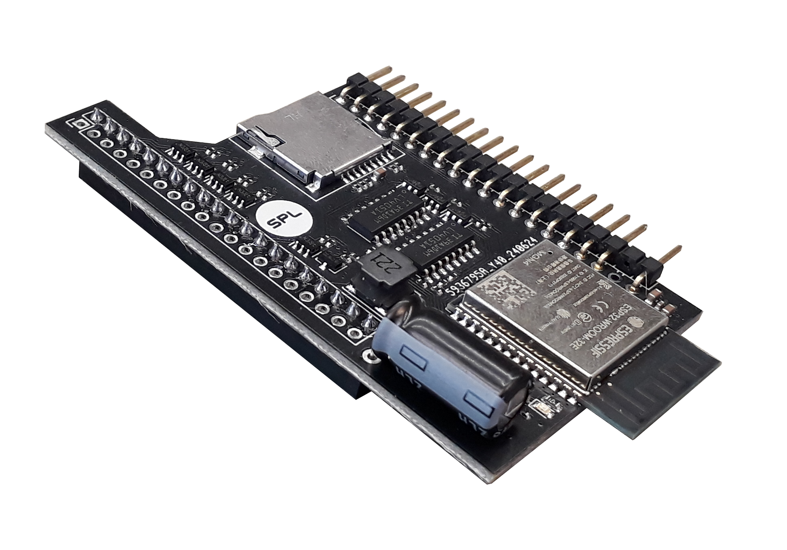
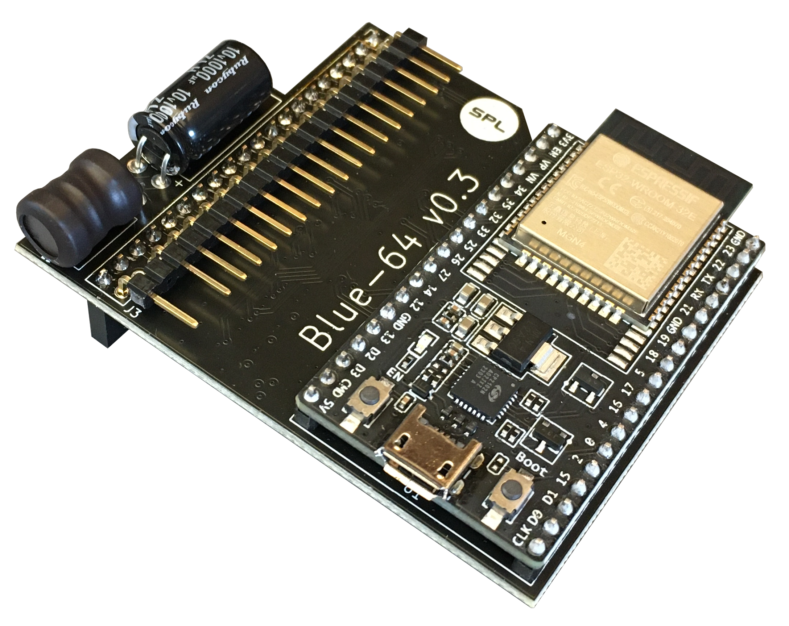

# BT-64

If you would like to get in touch with the developer, please join the SPL [Discord](https://discord.gg/gJsCgebkDw) server.

[FULL README (PDF)](https://raw.githubusercontent.com/sideprojectslab/blue-64/main/doc/README.pdf)

BT-64 is a plug & play bluetooth adapter for the Commodore 64 that plugs onto the keyboard header inside the computer and can control the keyboard lines and emulate keystrokes and joystick inputs. The goal of the project is to support two bluetooth controllers and a bluetooth keyboard simultaneously, in order to be able to controll the C64 completely wirelessly.

BT-64 can be purchased pre-assembled or as a DIY-Kit from these authorized shops:
- [Retro8BitShop](https://retro8bitshop.com/product/spl-blue-64-v1/)
- [Retro-Updates](https://www.retro-updates.com/product/15909946/blue-64-v1-0-plug-play-bluetooth-for-the-c64)

Sales of BT-64 by any shop other than the ones mentioned above may be in violation of the [License](#license) terms and conditions and should be reported to the developer

<figure align="center" id="blue_64_reg">
	
	<figcaption>BT-64 "Regular" Board</figcaption>
</figure>

<figure align="center" id="blue_64_dev">
	
	<figcaption>BT-64 Developer Board</figcaption>
</figure>

## Build Instructions
* Install ESP-IDF:
  * Download ESP-IDF 5.5.4 from the following [link](https://github.com/espressif/esp-idf/releases/tag/v5.5.4) and install it by following the ["get-started"](https://docs.espressif.com/projects/esp-idf/en/v5.5.4/esp32/get-started/index.html) instructions
  * Install dependencies with: `sudo apt install git wget flex bison gperf python3 python3-pip python3-venv cmake ninja-build ccache libffi-dev libssl-dev dfu-util libusb-1.0-0`
  * Copy ESP-IDF to the desired location, for instance: `~/Espressif/esp-idf-v5.5.4`
  * As explained in the guide, prior to installing ESP-IDF, set the ESP_IDF_TOOLS environment variable to the location where you want the various Espressif tools to be installed. A good way to make this permanent is to add the follwing line (or similar) to your ~/.bash_profile file, for instance: `export IDF_TOOLS_PATH="~/Espressif/tools"`
  * log-out and log-in again.
  * CD inside ESP-IDF folder and run `install.sh`
  * define the `ESP_IDF_5_5_4` environment variable in your `~/.bash_profile` pointing to the appropriate framework, for instance: `export ESP_IDF_5_5_4="~/Espressif/esp-idf-v5.5.4"`
  * Log-out and log-in again.
* CD to the BT-64 project's root
* setup the projects virtual environment by running `python3 _venv/setup.py`
* CD to `dev/sw/_make`
* activate the venv: (`source ../../../_venv/bin/activate` in Linux or `_venv/Scripts/activate` in Windows)
* run `inv`, invoke will run the complete build and generate the compilation outputs under `dump` inside the same `_make` folder

## License
License information is included on top of all software source files as well as in all schematics. Files that do not contain explicit licensing information are subject to the licensing terms stated in the LICENSE.txt provided in the main project folder:

Unless stated otherwise in individual files, all hardware design Schematics, Bill of Materials, Gerber files and manuals are licensed under Creative Commons Attribution-NonCommercial-NoDerivatives 4.0 International. To view a copy of this license, visit http://creativecommons.org/licenses/by-nc-nd/4.0/

Unless otherwise stated in individual files, all software source files are Licensed under the Apache License, Version 2.0. You may obtain a copy of this license at http://www.apache.org/licenses/LICENSE-2.0
